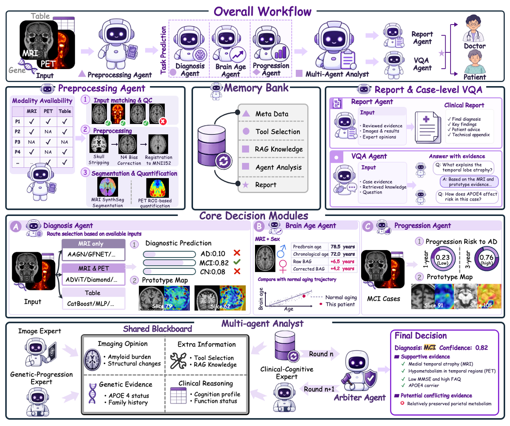
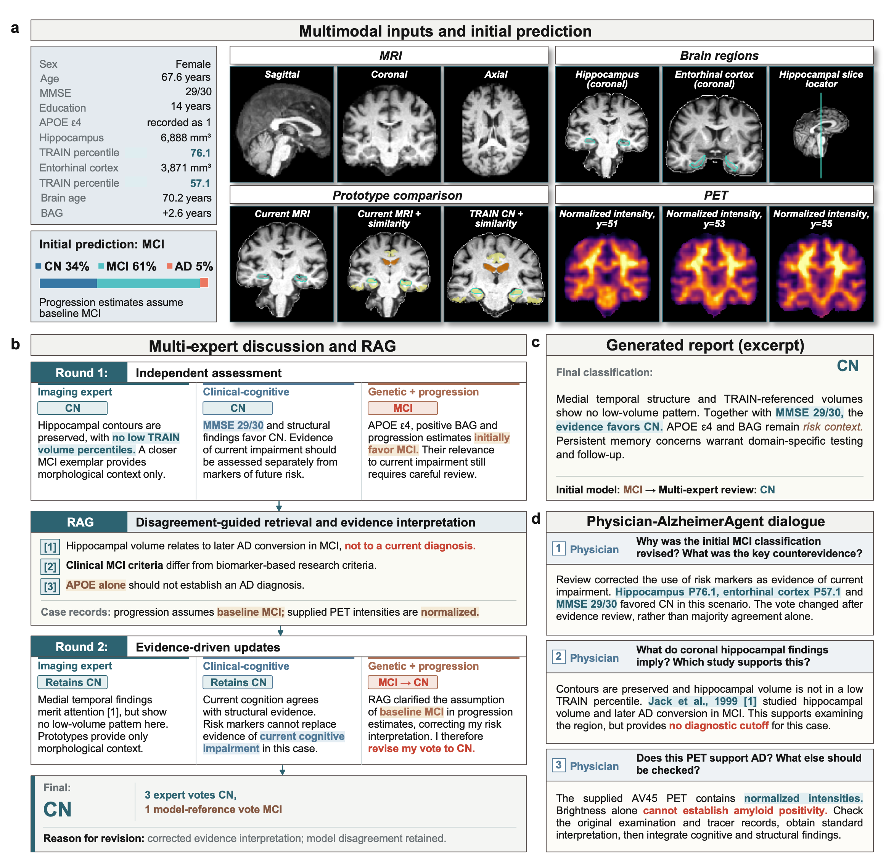
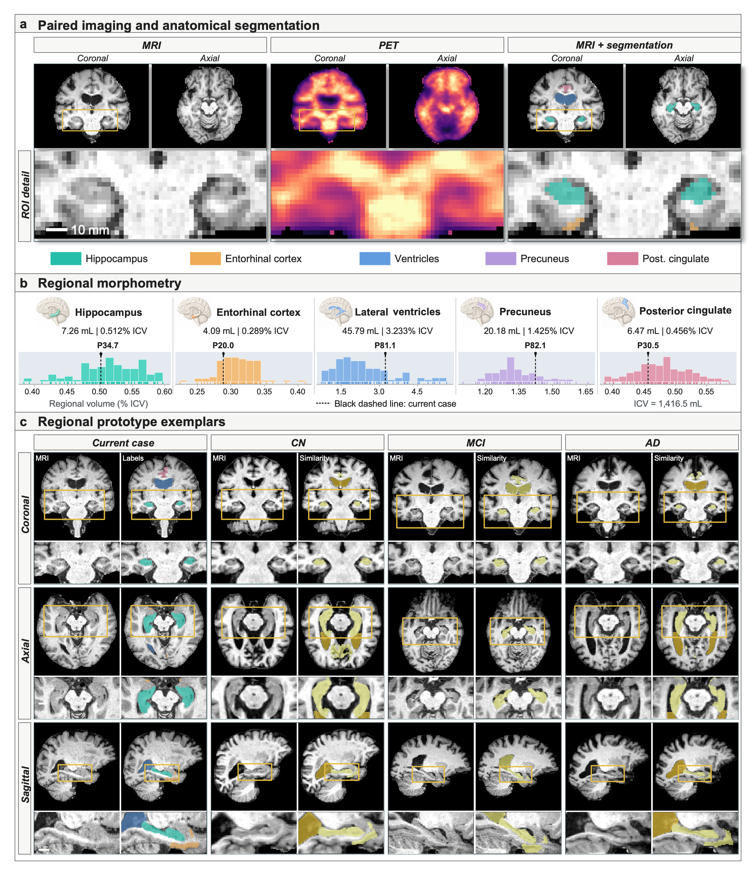
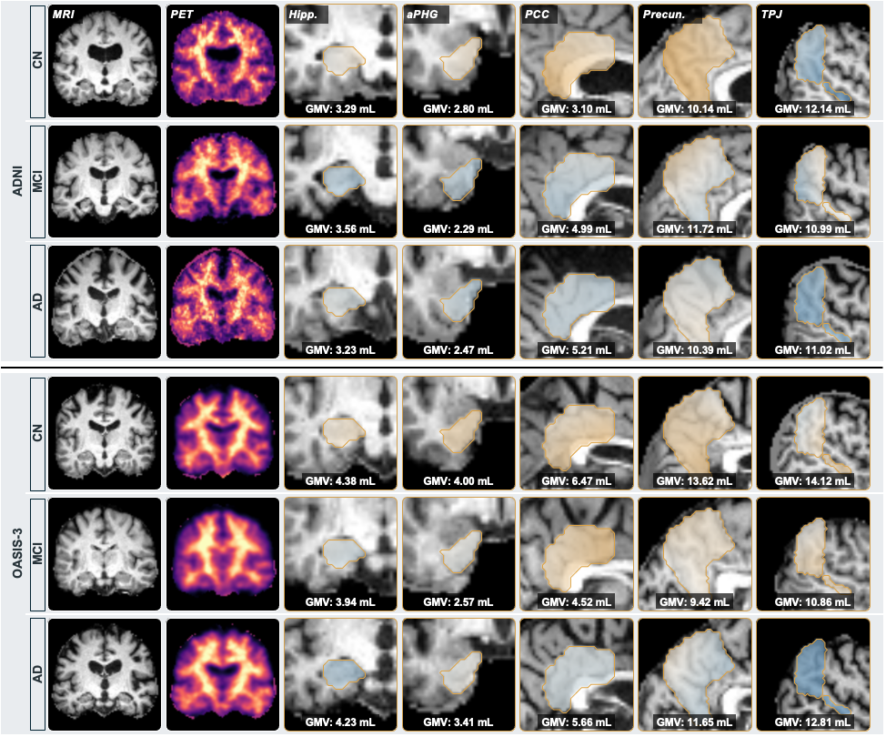
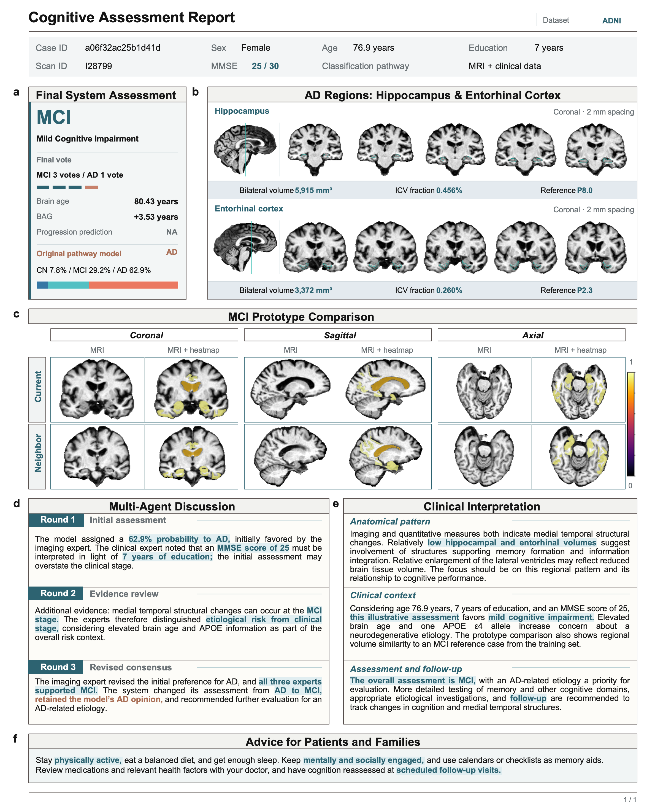

<div align="center">

# AlzheimerAgent

### Anatomy-Guided Multi-Agent Reasoning for Alzheimer’s Disease Assessment

**Anatomical evidence · Multimodal prediction · Traceable reasoning**

[Overview](#overview) · [Method](#method) · [Results](#results) · [Case Studies](#case-studies) · [Getting Started](#getting-started) · [Citation](#citation)

</div>

## Overview

AlzheimerAgent connects neuroimaging, clinical information, and task-specific models in a shared evidence workflow for Alzheimer’s disease assessment. It integrates **CN/MCI/AD classification**, **brain age estimation**, and **1-year and 3-year MCI-to-AD progression prediction**, followed by expert review, report generation, and visual question answering (VQA).

The central idea is to make an assessment traceable: regional measurements and anatomically matched prototypes accompany model predictions; expert conclusions retain their supporting evidence; reports and answers draw from the same verified case record.

<p align="center">
  
</p>

*Figure 1 from the manuscript. Shared imaging quantification and a Memory Bank connect prediction, evidence review, and interaction.*

This repository includes model components, training utilities, agent orchestration, report generation, and VQA.

## Method

### 1. Shared perception and anatomical evidence

MRI preprocessing combines bias-field correction, skull stripping, and registration. Regional brain volumes are measured in native space with explicit intracranial-volume normalization. When eligible PET is available, PET-to-MRI alignment connects regional uptake measurements to the same anatomy; the manuscript uses whole-cerebellum-referenced SUVR.

Region-constrained prototypes associate local imaging features with training references from the same anatomical region and class. Separate MRI and PET prototype banks contribute to the global prediction and preserve the provenance of their matched references.

### 2. Task-specific prediction

| Task | Target | Evidence and applicability |
|---|---|---|
| Clinical status | CN, MCI, or AD | Selects an eligible route from MRI + PET, MRI + clinical table, MRI, and clinical table |
| Brain age | Predicted age and brain-age gap | Uses MRI, optionally with sex; normal-aging training and independent CN calibration |
| Progression | MCI-to-AD risk at 1 or 3 years | Separate horizon-specific predictions for eligible baseline MCI cases, with follow-up-aware labels |

Route priority is **MRI + PET → MRI + Table → MRI → Table**, subject to input availability and quality checks. Ensemble members vote within the selected route; calibrated probabilities resolve vote ties when possible. Unresolved ties remain explicit.

Brain-age gap provides age-related context. It does not cast a disease-classification vote. Progression risk is conditional on the baseline MCI task and is kept separate from current clinical status.

### 3. Evidence review through a shared Memory Bank

The Memory Bank records measurements, predictions, image references, source versions, input hashes, timestamps, units, spatial information, and execution status. Original model outputs remain available alongside reviewed conclusions.

Three experts examine **imaging**, **clinical and cognitive findings**, and **genetic and progression evidence**. Their bounded review retains the initial model vote and requires support from at least two independent patient-evidence domains to revise a unique initial diagnosis. Multiple derivatives of the same MRI count as one domain; retrieved literature supplies context rather than an additional patient observation.

### 4. Reports and visual question answering

Report generation and VQA consume the same verified evidence. Quantitative statements resolve to recorded source values, image-dependent claims retain image references, and factual checks precede the final response. Missing inputs, failed tools, and unresolved conflicts remain explicit in the case record.

The reporting pipeline produces a clinician report, a patient-facing summary, and a structured technical appendix. VQA can request additional evidence through the tool interface and refer diagnostic conflicts back to the review process.

## Results

**Results reported in the manuscript.** Values are mean ± standard deviation across three seeds. Classification and progression metrics are percentages; brain-age errors and bias are in years. Within each table, *n* denotes evaluated records or visits, which may include repeated visits from a participant.

### Evaluation cohorts

The study includes **2,136 unique participants** across five cohorts. ADNI and OASIS-3 support development and internal evaluation; AIBL, OASIS-1, and OASIS-2 are reserved for external evaluation.

| Cohort | Unique participants | Role |
|---|---:|---|
| ADNI | 1,253 | Development and internal evaluation |
| OASIS-3 | 386 | Development and internal evaluation |
| AIBL | 112 | External evaluation |
| OASIS-1 | 235 | External evaluation |
| OASIS-2 | 150 | External evaluation |

### Clinical status classification

Selected AlzheimerAgent results from manuscript Tables 2–4. **FULL** denotes the combined evidence condition in the experiments, rather than an additional primary model route. Different input conditions can have different eligible samples.

| Evaluation | Input condition | n | Accuracy ↑ | Macro-F1 ↑ |
|---|---|---:|---:|---:|
| Internal | MRI | 263 | 61.60 ± 4.28 | 57.68 ± 4.81 |
| Internal | MRI + PET | 189 | 69.31 ± 1.83 | 64.74 ± 3.50 |
| Internal | MRI + Table | 263 | 65.65 ± 1.95 | 64.38 ± 3.07 |
| Internal | FULL | 189 | **75.49 ± 1.33** | **75.05 ± 1.12** |
| AIBL | MRI | 112 | 69.35 ± 3.38 | 44.23 ± 1.95 |
| AIBL | MRI + PET | 112 | 72.02 ± 3.61 | 47.09 ± 5.39 |
| AIBL | MRI + Table | 112 | 76.79 ± 1.55 | 51.15 ± 2.26 |
| AIBL | FULL | 112 | **78.87 ± 7.43** | **56.64 ± 7.64** |
| OASIS-1 | MRI + Table | 235 | 70.07 ± 2.14 | 62.75 ± 1.23 |
| OASIS-2 | MRI + Table | 373 | 71.85 ± 0.97 | 62.87 ± 0.98 |

Under the matched internal FULL condition, MeanFusion achieves 71.96 ± 1.40 accuracy and 71.51 ± 0.63 macro-F1. AlzheimerAgent improves these by **3.53** and **3.54 percentage points**, respectively. External performance varies by cohort and metric; AIBL is strongly imbalanced, with 85 CN, 26 MCI, and 1 AD participant.

### MCI-to-AD progression

Matched internal FULL-condition comparisons from manuscript Tables 5–6. F1 and AUPRC are included alongside AUROC to show performance under the observed class imbalance.

| Horizon | Method | n | Accuracy ↑ | F1 ↑ | AUROC ↑ | AUPRC ↑ |
|---|---|---:|---:|---:|---:|---:|
| 1 year | MeanFusion | 53 | 86.16 ± 5.76 | 37.30 ± 11.25 | 93.89 ± 2.27 | 58.06 ± 14.68 |
| 1 year | AlzheimerAgent | 53 | **89.31 ± 3.93** | **49.10 ± 9.47** | **97.11 ± 0.96** | **65.00 ± 5.29** |
| 3 years | MeanFusion | 45 | 82.22 ± 2.22 | 63.05 ± 7.88 | 88.30 ± 3.43 | 78.22 ± 5.49 |
| 3 years | AlzheimerAgent | 45 | **85.19 ± 4.63** | **70.29 ± 9.57** | **90.99 ± 1.39** | **82.01 ± 5.65** |

The external OASIS-2 3-year MRI + Table experiment contains only 24 eligible records and is exploratory: AUROC is 67.48 ± 3.34 and AUPRC is 69.55 ± 3.69 (manuscript Table 7).

### Brain age estimation

MRI + sex results from manuscript Tables 8–9. MAE and RMSE measure prediction error; R², correlation, and signed bias expose calibration and domain-shift behavior.

| Evaluation | n | MAE ↓ | RMSE ↓ | R² ↑ | Pearson r ↑ | Bias |
|---|---:|---:|---:|---:|---:|---:|
| Internal | 92 | **4.67 ± 0.19** | 6.25 ± 0.22 | 0.427 ± 0.041 | 0.658 ± 0.033 | +0.55 ± 0.24 |
| AIBL | 85 | 3.97 ± 0.41 | 4.94 ± 0.49 | 0.045 ± 0.183 | 0.575 ± 0.008 | −2.50 ± 0.55 |
| OASIS-1 | 135 | 7.06 ± 0.13 | 8.88 ± 0.13 | 0.587 ± 0.012 | 0.842 ± 0.013 | +0.67 ± 0.25 |
| OASIS-2 | 206 | 5.22 ± 0.08 | 6.61 ± 0.06 | 0.328 ± 0.013 | 0.728 ± 0.025 | −3.37 ± 0.35 |

## Case Studies

### Expert review and evidence-grounded VQA

<p align="center">
  
</p>

*Figure 4 from the manuscript. A worked case connects the initial prediction, evidence from independent patient domains, the reviewed assessment, and follow-up questions. This is an illustrative case, not an additional performance estimate.*

<details>
<summary><strong>Anatomical quantification and regional references · Figure 2</strong></summary>

<p align="center">
  
</p>

Regional measurements retain their anatomical context and training-reference distributions. Image intensity alone is not a quantified PET SUVR measurement.

</details>

<details>
<summary><strong>Region-constrained prototype evidence · Figure 3</strong></summary>

<p align="center">
  
</p>

Held-out examples from ADNI and OASIS-3 pair regional gray-matter volumes with anatomically matched CN-prototype similarities.

</details>

<details>
<summary><strong>Integrated report and patient summary · Figure 5</strong></summary>

<p align="center">
  
</p>

The final case presentation brings task outputs and their evidence into a clinical report and a patient-facing summary.

</details>

## Getting Started

### Installation

Use **Python 3.10 or later**. Run the following commands from the repository root:

```bash
python -m venv .venv
source .venv/bin/activate
python -m pip install -e '.[models,imaging,test]'
```

The core agent package depends on NumPy. Optional dependency groups add PyTorch and modeling utilities (`models`), neuroimaging utilities (`imaging`), SHAP (`explain`), and pytest (`test`). Dependency ranges are declared in [pyproject.toml](pyproject.toml).

### Run the synthetic workflow

```bash
python -m alzheimer_agent demo --output outputs/demo
```

The demo exercises routing, evidence review, reporting, and VQA with a deterministic synthetic backend. It requires no dataset, checkpoint, or external API, and does not perform real image inference or demonstrate clinical performance. Choose a new output directory for each run.

```text
outputs/demo/
├── result.json
├── clinician_report.md
├── patient_summary.md
└── technical_appendix.json
```

`result.json` contains the structured case result and VQA answers. The other files expose the two report views and their technical evidence record.

### Connect a case and a backend

The backend contract is defined in [backends.py](src/alzheimer_agent/backends.py):

```python
def complete(self, *, task: str, system: str, payload: dict, images: list[dict]) -> dict:
    ...
```

Implement this interface in an importable class with a no-argument constructor. Task-specific schemas are specified by the [prompts](src/alzheimer_agent/prompts) and validated by the agent, report, and VQA modules. [demo.py](src/alzheimer_agent/demo.py) provides a minimal case structure with inputs, evidence records, and pathway predictions.

With your own `case.json` and backend implementation available:

```bash
python -m alzheimer_agent run \
  --case /path/to/case.json \
  --backend my_backend:Backend \
  --question "Which evidence supports the reviewed assessment?" \
  --output outputs/case_review
```

The case must contain prepared evidence and model outputs; this command does not automatically turn a raw scan into a complete assessment. Custom retrieval and tool scheduling can be connected through the Python [pipeline](src/alzheimer_agent/pipeline.py).

## Data and Model Workflow

### Manifest contract

Training and prediction use a JSONL manifest with one record per visit. [data.py](src/alzheimer_agent/data.py) defines the full schema and validation rules.

| Field group | Required content |
|---|---|
| Identity and partition | `patient`, `visit`, `cohort`, `split`; all visits from one participant remain in one partition |
| Partitions | `TRAIN`, `VALIDATION`, `CALIBRATION`, `TEST`, or `OOD`; AIBL, OASIS1, and OASIS2 use `OOD` |
| Classification | Integer `label`: CN = 0, MCI = 1, AD = 2 |
| Imaging | Image paths, QC status, spatial verification, atlas path and version; compatible image and atlas grids |
| MRI + PET | Both inputs pass QC and acquisition dates are within 30 days |
| Clinical table | Age, sex, education years, MMSE, CDR-SB, and APOE4, with explicit missingness |
| Brain age | `age`, `clinical_label`, and rigidly aligned 1 mm MRI of size 192 × 192 × 192; `sex` for the sex-conditioned model |
| Progression | `baseline`, `conversion_years`, and `followup_years`; horizon-specific censoring determines eligibility |

Table normalization is fitted on training data. Brain-age training and calibration use CN records. Progression training additionally requires CN and AD training references. Participants without adequate follow-up are not silently assigned a negative progression label.

### Prepare images

```bash
python -m alzheimer_agent preprocess \
  --mri /path/to/T1w.nii.gz \
  --pet /path/to/PET.nii.gz \
  --template /path/to/MNI152NLin2009cAsym_1mm.nii.gz \
  --brain-age-reference /path/to/brain_age_reference_192.nii.gz \
  --output outputs/preprocessing
```

This prints the preprocessing plan. Add `--execute` to run it after installing the required N4, SynthStrip, ANTs, and SynthSeg tools and supplying the appropriate reference files. Omit `--pet` for MRI-only cases. Registration and segmentation outputs require QC before entering the manifest.

### Train, project, and calibrate

The following illustrates the order for an MRI classification run using your prepared manifest and reviewed ROI configuration:

```bash
python -m alzheimer_agent train \
  --manifest /path/to/manifest.jsonl \
  --spec configs/diagnosis_mri.json \
  --seed 3407 \
  --device cuda \
  --output outputs/diagnosis_mri_s3407

python scripts/project_prototypes.py \
  --checkpoint outputs/diagnosis_mri_s3407/best.pt \
  --manifest /path/to/manifest.jsonl \
  --device cuda \
  --output outputs/diagnosis_mri_s3407_projected

python scripts/predict.py \
  --checkpoint outputs/diagnosis_mri_s3407_projected/projected.pt \
  --manifest /path/to/manifest.jsonl \
  --split CALIBRATION \
  --device cuda \
  --output outputs/calibration_logits.json

python scripts/calibrate.py \
  --kind temperature \
  --input outputs/calibration_logits.json \
  --version mri_s3407_temperature_v1 \
  --output outputs/temperature.json

python scripts/predict.py \
  --checkpoint outputs/diagnosis_mri_s3407_projected/projected.pt \
  --manifest /path/to/manifest.jsonl \
  --split TEST \
  --calibration outputs/temperature.json \
  --device cuda \
  --output outputs/test_predictions.json
```

Projection uses training references; temperature calibration uses the separate `CALIBRATION` partition. Both must be completed before interpreting calibrated test outputs. Repeat with distinct output paths for seeds `3408` and `3409` when running the three-seed protocol.

The default training configuration uses AdamW, an initial learning rate of `1e-4`, weight decay of `1e-2`, cosine decay to `1e-6`, an effective batch size of 8, and a maximum of 120 epochs. Early stopping starts after 30 epochs with patience 25. The CLI instantiates `TrainingConfig` in [training.py](src/alzheimer_agent/training.py); [configs/training.json](configs/training.json) records the defaults but is not loaded by the CLI.

### Available model specifications

| Task | Configuration |
|---|---|
| MRI classification | [diagnosis_mri.json](configs/diagnosis_mri.json) |
| MRI + PET classification | [diagnosis_mri_pet.json](configs/diagnosis_mri_pet.json) |
| MRI + Table classification | [diagnosis_mri_table.json](configs/diagnosis_mri_table.json) |
| Table classification | [diagnosis_table.json](configs/diagnosis_table.json) |
| MRI progression at 1 / 3 years | [progression_1y.json](configs/progression_1y.json) / [progression_3y.json](configs/progression_3y.json) |
| Author BrainMRI, MRI / MRI + sex | [brain_age_mri.json](configs/brain_age_mri.json) / [brain_age_mri_sex.json](configs/brain_age_mri_sex.json) |
| Standalone brain-age model | [brain_age_standalone.json](configs/brain_age_standalone.json) |

For the author BrainMRI adapter, supply `MetaBrain.py`, `MetaTransformer.py`, and `Module.py` from the [BrainMRI repository](https://github.com/ChenxiWang98/BrainMRI) under `third_party/BrainMRI`, or update `source_dir` in the configuration. The standalone brain-age model is a separate implementation and should not be treated as the author architecture.

Brain-age outputs use `scripts/calibrate.py --kind bag` with CN-only calibration predictions to fit the age-bias correction. Brain-age models do not use prototype projection. Metric functions for classification, progression, and brain age are provided in [evaluation.py](src/alzheimer_agent/evaluation.py).

## Repository Structure

```text
AlzheimerAgent/
├── assets/figures/
├── configs/
├── scripts/
│   ├── calibrate.py
│   ├── predict.py
│   └── project_prototypes.py
├── src/alzheimer_agent/
│   ├── models/
│   │   ├── core.py
│   │   ├── prototypes.py
│   │   ├── brainmri.py
│   │   ├── gated.py
│   │   └── routes.py
│   ├── prompts/
│   ├── agents.py
│   ├── memory.py
│   ├── pipeline.py
│   ├── routing.py
│   ├── retrieval.py
│   ├── reporting.py
│   ├── vqa.py
│   ├── tools.py
│   ├── preprocessing.py
│   ├── data.py
│   ├── training.py
│   ├── projection.py
│   ├── calibration.py
│   ├── inference.py
│   └── evaluation.py
├── tests/
└── pyproject.toml
```

## Validation

```bash
python -m pytest -q
```

The test suite covers synthetic cases, evidence handling, routing, calibration, model components, and report/VQA behavior.

## Citation

```bibtex
@misc{wu2026alzheimeragent,
  title = {AlzheimerAgent: Anatomy-Guided Multi-Agent Reasoning for Alzheimer's Disease Assessment},
  author = {Wu, Beining and Chen, Yifei and Mao, Fuyou and Jiang, Chunbo and Bao, Enyu and Liu, Mingxuan and Li, Zihan and Shao, Zhuojun and Chen, Xiaxuan and Qin, Feiwei and Liu, Yong and Lu, Jie and Tian, Qiyuan},
  year = {2026},
  note = {Unpublished manuscript}
}
```
